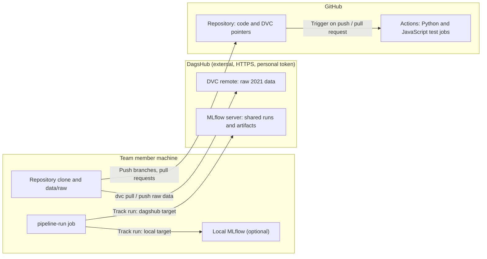
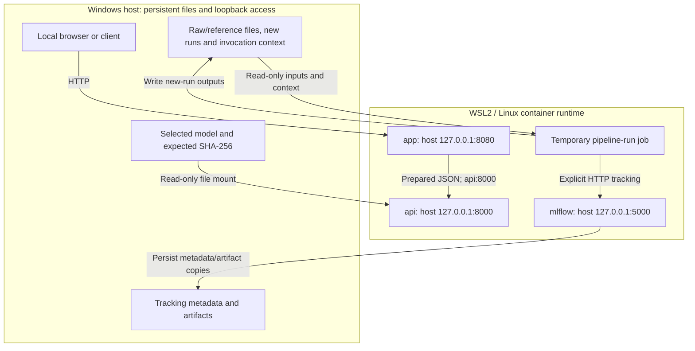
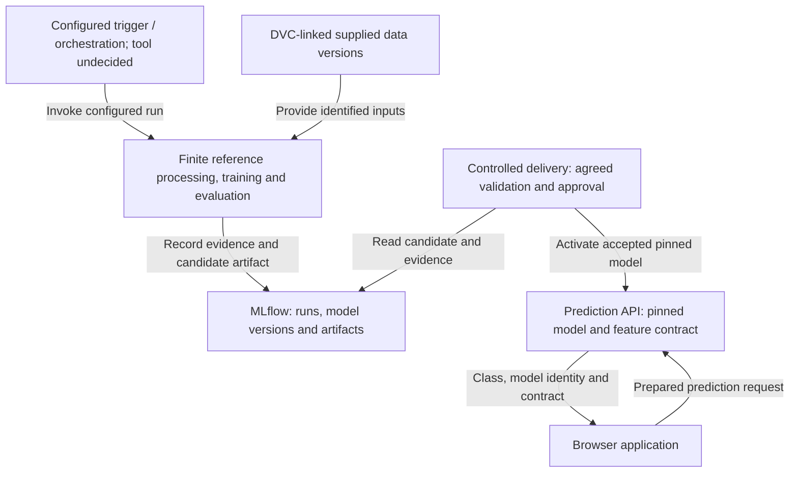
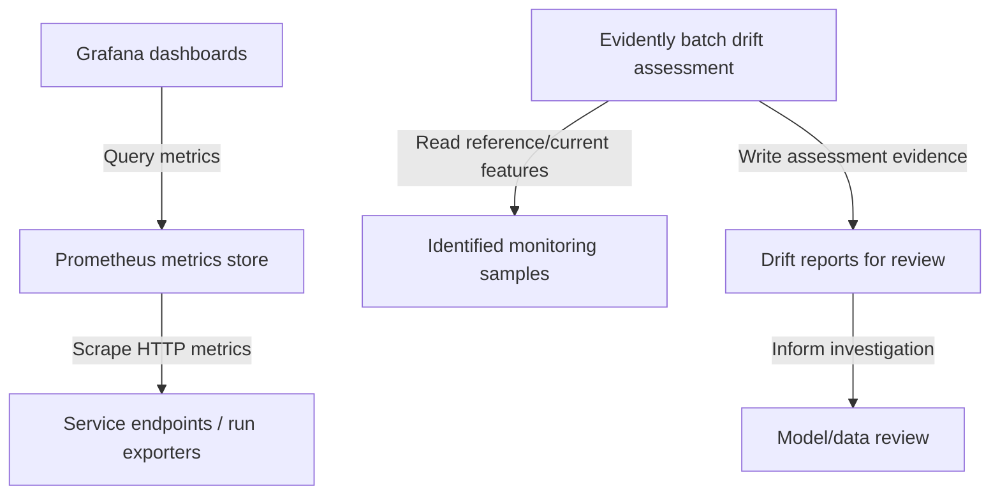
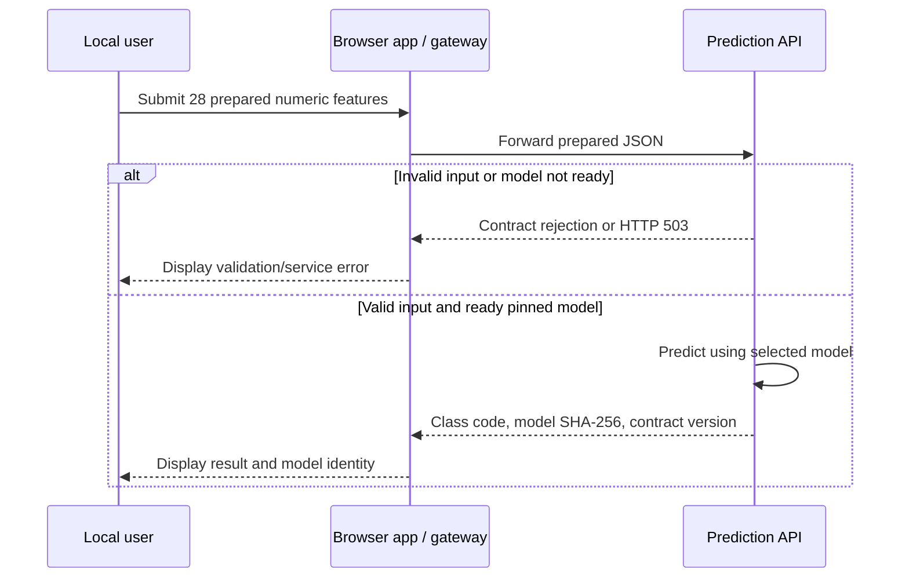

# Road Accident MLOps Architecture

Project: car_accident. Document date: 2026-10-21. Status: NON_FINAL.
Delivery approval: false. Educational demonstration; operational police use
is not approved or validated.

## Evidence and source roles

This document separates dated source descriptions, observed console output and
proposed architecture. It introduces no runtime or deployment validation.

| Source | What it supports | Limit |
| --- | --- | --- |
| Architecture text dated 2026-10-11 | Descriptions of local code paths and configured boundaries below | No fresh implementation audit in this update |
| Local inventory, 2026-10-21T15:14:05.5679058Z | Branch work/raw-import-unit-tests, HEAD 6e2872496eded66cbbdb790cdcc8d4acbf8cf8da; prior architecture SHA-256 37c156532b9e92ad45a450fcfe28bba32575f5dac2e9fc33f70603f6a67ee049 | Supplied console evidence; no remote refresh or code execution |
| Local API/app observation, 2026-10-21T10:06:46.5283466Z–10:07:03.8135471Z | Both expected containers reported running and healthy; no model switch; delivery approval false | Only that window, not present availability or full functional acceptance |
| Functional report: data/runs/validation_20261003T193310Z_56c49087/validation_report.json | Historical source/data/model hashes and reference metrics described in the previous architecture | Report not re-executed or independently reread for this documentation update |
| Repository configuration on master, 2026-10-22 | Shared DagsHub storage and tracking target, CI jobs (section "Shared storage, tracking target and CI") | Configuration and recorded checks; no new pipeline run |
| Mentor roadmap dated 2026-10-01 and discussion dated 2026-10-15 | Planning direction and distinction between component architecture and use-case flows | Not execution authority or a final assessment rubric |

The French original project brief governs interpretation of the English
translation. Original briefs, mentor material and historical reports remain
source records. Planned architecture is neither implementation evidence nor
an approved deployment specification. Mentor roadmap phases are independent of
MLOps acceptance levels: Level 1 is mandatory; Level 2 is a separate extension.

## Reference model and prediction contract

Preserve the supplied 2021 data, preprocessing and Random Forest approach.
Model semantics change only after a necessary correction is specified by the
mentor and the team agrees to the resulting change.

- Four supplied raw CSVs feed the inherited merging, recoding, feature
  calculations and severity-dependent road-user row selection.
- The split is 70/30 with random_state=42. Missing values in surf, circ, col and
  motor use modes derived from the training partition and applied to both
  partitions.
- Training retains RandomForestClassifier(n_jobs=-1) without a fixed estimator
  seed. Repeated fits may differ; repeatable workflow execution is not a claim
  of byte-identical models or identical predictions.
- The contract uses 28 ordered prepared numeric features, finite values,
  resolved missing values and target/model classes 0 and 1. The interface
  contract is prepared-features-v1; responses include class code and model
  SHA-256. Domain labels remain unconfirmed.
- Inherited recoding maps original values [1, 2, 3, 4] to [1, 1, 1, 0]. Selection
  using observed severity limits claims about information available before
  intervention. Record these limitations without silently changing semantics.
- Raw-input conversion remains separate. The prepared-feature example does
  not establish a complete ordinary-user-input pipeline.

## Dated implementation description

The following describes the source architecture supplied from the 2026-10-11
document. It does not assert that every described component is running now.

### Finite pipeline and tracking

The pipeline creates a new run directory, performs reference preprocessing and
training, checks both prepared partitions and the saved model contract, then
writes the technical report and local run status. Data checks require nonempty
partitions, matching rows, ordered features, finite numeric values and binary
targets. Model checks inspect estimator type, feature contract and classes;
they perform no inference or holdout scoring.

The technical report records run/model identities and UTC verification times.
Technical, tracking, artifact or final-status writing failures prevent successful
completion and return exit 1. Failure handling preserves the primary error and
partial artifacts, attempts failure recording and retains uncertain remote
outcomes without automatic retry. Completed training does not confer delivery
approval. Evaluation currently belongs to a separate functional procedure and
does not determine technical pipeline completion. Automated reference evaluation
remains an agreed Level 1 outcome; criteria must be agreed before enforcement.

The existing untracked workspace invocation remains available. Explicit tracked
runs use a finite pipeline-run job and a manual PowerShell launcher that records
invocation context and pins the actual image ID. It starts no dependencies and
requires an existing MLflow service. Tracking links invocation/local/remote run
identities, actual sources/inputs/configuration/environment, technical report and
model hash. Verified artifact copies and confirmed metadata are required for
tracked local completion. New outputs are not automatically DVC-versioned.

### Historical import and versioning

The historical tracking-import tool copies the preserved reference report,
status and model into MLflow while keeping original timestamps and approval
state. Original historical training Git/image identities remain unknown; import
or registration observations do not replace them. Sequential import verification
is distinct from tracking new pipeline runs.

The supplied source description pins local MLflow 3.17.0 and finite DVC 3.67.1
tooling. These are dated configurations, not recommended upgrades or proof of
current installations. DVC metadata covers raw/prepared/reference artifacts and
the preserved reference run/report. Recovery described by the historical
procedure uses an empty isolated cache and compares 16 recovered file hashes.
This document establishes no new recovery result. DVC_SITE_CACHE_DIR=/tmp/dvc-site-cache
separates temporary tool state from persistent content. Local object storage
does not establish protection against loss of the host drive.

### Shared storage, tracking target and CI

Added 2026-10-22. These parts were configured after the 2026-10-11 source.

- **DVC remote:** `.dvc/config` sets `dagshub`
  (`https://dagshub.com/SiR1979/prediction_severity_car_accidents.dvc`) as the
  default remote. It holds only the four raw 2021 CSVs (`versioning/raw_2021.dvc`).
  Prepared data, models and run artifacts are not on the shared remote.
  Each person authenticates with their own DagsHub token in the Git-ignored
  `.dvc/config.local`; see versioning.md.
- **MLflow tracking target:** new pipeline runs can be tracked either on the
  local MLflow 3.17.0 service or on the DagsHub MLflow server
  (`https://dagshub.com/SiR1979/prediction_severity_car_accidents.mlflow`, MLflow
  3.x). The tracking URI selects the target. DagsHub uses verified HTTPS and the
  personal token from `MLFLOW_TRACKING_USERNAME`/`MLFLOW_TRACKING_PASSWORD`; the
  token is not recorded in tags, provenance or artifacts. Provenance and artifact
  hash checks are identical for both targets; runs carry `tracking_target` and
  `tracking_server_version`. See tracking.md.
- **CI:** `.github/workflows/python-app.yml` runs on pushes and pull requests to
  `master` with two independent jobs: Python 3.11 with the pinned runtime, API
  and tracking requirements, flake8 and pytest; and the JavaScript app-logic
  tests on Node.js 24. CI runs unit tests with test doubles only; it performs no
  real training, DVC transfer or deployment.



Legend: arrows show the direction of transfer or triggering. A run uses one
tracking target. The diagram shows configured connections, not availability.

### Storage and provenance

| Location | Described role |
| --- | --- |
| data/raw/ | Supplied raw CSVs |
| data/runs/<run_id>/preprocessed/ | Four prepared outputs for a new run |
| data/runs/<run_id>/model/trained_model.joblib | Newly trained artifact |
| data/runs/<run_id>/validation_report.json | Technical report; no evaluation metrics |
| data/runs/<run_id>/run_status.json | Local completion/failure state |
| New-run tracking_evidence/ files | Invocation, provenance and verified artifact linkage |
| data/run_invocations/ | Launcher context |
| data/preprocessed/ and src/models/trained_model.joblib | Preserved reference data/model |
| data/reference_snapshots/20261003T182822Z_3490e1df/ | Preserved reference snapshot |
| data/tracking/ | MLflow SQLite metadata and artifact copies |
| DagsHub DVC remote | Shared copy of the raw 2021 data only |
| DagsHub MLflow server | Shared tracking of runs that select the dagshub target |
| versioning/ | Small DVC pointers and registration metadata |

Source presence, tests with doubles, historical imports and recovered reference
artifacts each establish only their recorded scope. None alone proves a new real
training run, complete future-run lineage, accepted model delivery or Level 1.

## Configured deployment view — dated source description

View status: configuration described in the 2026-10-11 source. Host/runtime:
Windows, WSL2 and Linux containers. This is not a current service inventory.



Legend: boxes are host resources or configured services/jobs; labelled arrows
describe dependencies or transfers, not readiness or an execution sequence.
The graph summarises the optional tracked-job boundaries. The base workspace
retains two writable bind mounts and is separate from the restricted tracked
job. Source updates included in an image require rebuilding that image;
src/models is mounted over the corresponding workspace image path, so executed
scripts can differ from image contents. Reference/output protections in the
base workspace are application rules, not read-only mount enforcement.

The API loads one selected read-only artifact at startup. Expected SHA-256,
estimator, feature names/order/count and class checks determine readiness;
an invalid model yields HTTP 503 for readiness/predictions. The app is a separate
form and fixed API gateway with no model/data/repository bind mounts. Blank
fields remain required, edits clear old results and no category labels are
inferred. It forwards prepared JSON to the API. App readiness depends on API
readiness; these endpoints do not establish continuous monitoring or quality
approval. See api-contract.md, local-app.md, tracking.md and versioning.md for
the detailed component contracts and dated evidence.

## Proposed logical target — components and responsibilities

View status: target design only. No deployment topology or release authority
is implied. Logical responsibilities do not require an always-on service for
each stage; finite jobs remain valid.



Legend: every box and relationship is part of the target view. Arrows name the
interaction in their direction; they do not label implementation status or
constitute a chronological workflow. Model delivery is a controlled automation
responsibility, not an additional mandatory persistent service. Agreed runtime
and validation thresholds must precede enforcement. Failed candidates must not
be served. No new quality threshold or acceptance rule is introduced here.

### Proposed monitoring view

View status: target design only; the same system is shown from the monitoring
perspective. Endpoint/exporter implementation and data retention remain open.



Legend: arrows identify callers/readers or writers explicitly. Drift reports
inform review; they do not automatically activate a model. Drift is an
unlabelled indicator; predictive performance requires suitable labels. Track
pipeline failures and service health separately from labelled model quality.
Monitoring diagrams do not authorise retraining, deployment or publication.

## Use-case views

### Prepared-feature prediction — dated source-described behaviour

This sequence describes the application/API contract in the supplied source.
It is not a newly executed request. The API's model is already loaded and
verified at startup; the sequence does not reload it for each prediction.



Legend: solid arrows are calls/actions; dashed arrows are responses. Conditional
branches express described validation outcomes, not live test results.

### Candidate training and delivery — proposed workflow

This is the target sequence, separate from component structure and deployment.
The model-version and delivery mechanisms remain subject to the agreed scope
and release policy; no specific reload endpoint is prescribed.

```mermaid
sequenceDiagram
    participant Trigger as Configured trigger
    participant Train as Training job
    participant Store as Versioned model / evidence store
    participant Delivery as Controlled delivery
    participant API as Prediction service
    Trigger->>Train: Start identified supplied-data run
    Train->>Train: Process, train, validate and record evaluation
    alt Candidate fails agreed validation
        Train-->>Trigger: Failed run; preserve evidence
    else Candidate passes agreed validation
        Train->>Store: Store versioned artifact and traceability
        Store-->>Train: Confirm stored identities
        Delivery->>Store: Read candidate and required evidence
        alt Release authority and policy allow delivery
            Delivery->>API: Activate pinned artifact by agreed mechanism
            API-->>Delivery: Return model identity and health evidence
        else Approval or required evidence missing
            Delivery->>Delivery: Keep existing serving model
        end
    end
```

Legend: calls and responses are directional; alternatives show rejection and
controlled delivery. Successful training is not delivery approval. Required
runtime checks and proportionate recovery belong to the agreed delivery step.
This diagram authorises no operation.

## Remaining work and maintenance

- Evidence configured triggering, automated reference evaluation, future-run
  data/model version linkage, accepted-model delivery and agreed monitoring
  before claiming Level 1 completion. Track Level 2 separately.
- Do not infer completed integration from historical import, reference recovery,
  a model artifact, service health or a green test result outside its scope.
- Raw-input conversion, domain class interpretation, prediction-time feature
  availability, agreed thresholds, deployment/access/recovery choices and full
  dependency/base-image locking remain separate decisions or limitations.
- Update the relevant view when responsibilities, paths or boundaries change.
  Record dates/versions when changing implementation claims; preserve historical
  reports and source notices. Keep target elements visibly labelled until
  implementation is evidenced. Do not present this document as live state.
